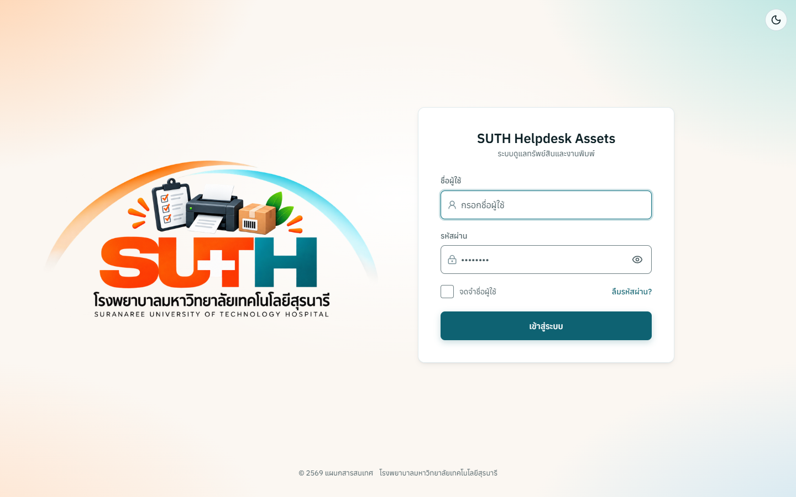

# SUTH Helpdesk Assets — โครงงานฝึกงาน

**ระบบบริหารทรัพย์สิน IT และงานพิมพ์ของโรงพยาบาล**

**ผู้พัฒนา:** [WayuOHm99](https://github.com/WayuOHm99)
**ช่วงฝึกงาน:** 8 มิถุนายน–12 ตุลาคม 2026
**บทบาท:** ผู้พัฒนาหลัก รับผิดชอบการพัฒนาระบบครบวงจรภายใต้การดูแลของพี่เลี้ยง

โครงงานเว็บสำหรับเจ้าหน้าที่ IT เพื่อจัดการทะเบียนเครื่องพิมพ์ สัญญา จำนวนพิมพ์รายเดือน การนำเข้าข้อมูล และรายงานค่าใช้จ่ายตามปีงบประมาณ รับผิดชอบทั้งหน้าเว็บ API การทดสอบ เอกสาร และการส่งมอบ โดยคงเครดิตของผู้ร่วมพัฒนาทุกคนจาก [โครงการต้นทาง](https://github.com/saritrungj/suth-helpdesk-assets)

รายละเอียดผลงาน หลักฐาน และข้อความสำหรับ CV อยู่ใน [กรณีศึกษาจากงานจริง](docs/portfolio/README.md)

## ภาพตัวอย่างระบบ

*หน้าเข้าสู่ระบบภาษาไทย ถ่ายวันที่ 12 ตุลาคม 2026 ช่องชื่อผู้ใช้และรหัสผ่านว่าง โดยจุดในช่องรหัสผ่านเป็นข้อความตัวอย่างของช่องกรอก ไม่ได้เชื่อมต่อ API จริง ดู [ภาพ Dashboard ทะเบียนเครื่องพิมพ์ และค่าใช้จ่ายจากข้อมูลจำลอง](docs/portfolio/README.md#ภาพตัวอย่างจากข้อมูลจำลอง)*

## ผลงานเด่น

| งาน | สิ่งที่ออกแบบและพัฒนา | หลักฐาน |
|---|---|---|
| Dashboard วิเคราะห์การพิมพ์ | ให้ตัวกรองชุดเดียวควบคุม KPI กราฟ ตาราง และไฟล์ส่งออก พร้อมเก็บสถานะใน URL | [PR #127](https://github.com/saritrungj/suth-helpdesk-assets/pull/127) |
| ตรวจแผนก่อนยืนยันนำเข้า | แสดงสิ่งที่จะเปลี่ยนก่อนบันทึกข้อมูลธุรกิจ | [PR #210](https://github.com/saritrungj/suth-helpdesk-assets/pull/210) |
| รองรับ CSV ภาษาไทย | ถอดรหัส UTF-8, UTF-16 และ Windows-874 พร้อมจัดการไฟล์ที่อ่านไม่ได้ | [PR #234](https://github.com/saritrungj/suth-helpdesk-assets/pull/234) |
| ตรวจการเข้าถึงหน้าเว็บ | เพิ่มการตรวจตามหน้า บทบาท และสถานะ ทั้งธีมสว่าง/มืดและหลายขนาดหน้าจอ | [PR #293](https://github.com/saritrungj/suth-helpdesk-assets/pull/293) |
| เทสค่าใช้จ่ายและการนำเข้าซ้ำ | ตรวจผลหลังแก้ราคาและการเขียนทับจำนวนพิมพ์ โดยไม่เพิ่มยอดซ้ำ | [PR #328](https://github.com/saritrungj/suth-helpdesk-assets/pull/328) |

ผลทดสอบในกรณีศึกษาเป็นหลักฐานจาก PR ณ เวลาส่งงาน ส่วนการตรวจสำเนา Portfolio รอบนี้รายงานแยกไว้ใน [ผลตรวจความครบถ้วน](docs/portfolio/audit-2026-10-12.md)

## เทคโนโลยีและโครงสร้าง

- **หน้าเว็บ:** Vue 3, Vite, Tailwind CSS v4, TanStack Query, Reka UI และ Lightweight Charts
- **API:** Node.js, Express, MySQL, zod และ JWT session ผ่าน httpOnly cookie
- **กฎธุรกิจร่วมกัน:** packages/domain สำหรับปีงบ วันที่ เงิน และภาษา
- **การตรวจสอบ:** Node.js tests, Vitest, Playwright, axe และฐาน MySQL QA แยก

หน้าเว็บเรียก Express ผ่าน HTTP API ซึ่งตรวจสิทธิ์และกฎก่อนเข้าถึง MySQL ทั้งเว็บและ API ใช้กฎจาก packages/domain ร่วมกัน รายละเอียดอยู่ใน [สถาปัตยกรรม](docs/explanation/architecture.md) และ [กฎธุรกิจ](docs/explanation/domain.md)

## เปิดระบบในเครื่อง

ต้องมี Node.js 20 ขึ้นไป, npm และ MySQL 8.4 หรือ Docker Desktop เตรียม environment และข้อมูลจำลองตาม [คู่มือตั้งระบบ](docs/how-to/set-up-development.md) และ [ฐานพัฒนาบน Docker](docs/how-to/run-docker-database.md)

    npm install
    npm run dev:api
    # เปิดอีก terminal:
    npm run dev:web

ภาพใน Portfolio ใช้ข้อมูลจำลอง สำเนานี้ไม่มี environment ที่พร้อมใช้กับ production หรือไฟล์สำรองฐานข้อมูลจริง ปัจจุบันยังไม่มีเว็บสาธิตออนไลน์หรือคลิปแนะนำ

## เอกสารและการพัฒนาต่อ

- [กรณีศึกษา ข้อความ CV ไทย/อังกฤษ และประเด็นสัมภาษณ์](docs/portfolio/README.md)
- [ผลตรวจความครบถ้วนและข้อที่ยังไม่ยืนยัน](docs/portfolio/audit-2026-10-12.md)
- [สารบัญเอกสารโครงการ](docs/README.md)
- [คู่มือตรวจการเปลี่ยนแปลง](docs/how-to/verify-changes.md)
- [Issue tracker ของ Repo ส่วนตัว](https://github.com/WayuOHm99/suth-helpdesk-assets-portfolio/issues)
- [แนวทางทำงานและส่ง PR](CONTRIBUTING.md)

บันทึกการติดตั้งที่สืบทอดมาจากต้นทางอธิบายระบบต้นทาง ไม่ใช่การติดตั้งของ Repo ส่วนตัวนี้

## ที่มาและเครดิต

สำเนา Portfolio นี้แยกจาก [saritrungj/suth-helpdesk-assets](https://github.com/saritrungj/suth-helpdesk-assets) เมื่อ 12 ตุลาคม 2026 คงชื่อผู้ร่วมพัฒนา เอกสาร และ [ไฟล์ LICENSE เดิม](LICENSE) ไว้ ข้อมูลสัญญาอนุญาตใน package.json ที่สืบทอดมายังมีข้อความต่างจากไฟล์ LICENSE ดูรายละเอียดในรายงานตรวจ

ก่อนอัปโหลด นำไฟล์ environment เก่า ไฟล์อัปโหลด spreadsheets ใน docs และ dependency folders ออกจากประวัติสำเนานี้แล้ว จึงอาจมี commit ID ต่างจากต้นทาง ลิงก์ PR ต้นทางยังเป็นหลักฐานอ้างอิง ส่วนชุดสำรองดั้งเดิมและข้อมูลปฏิบัติการเก็บแยกเป็นส่วนตัวในเครื่อง