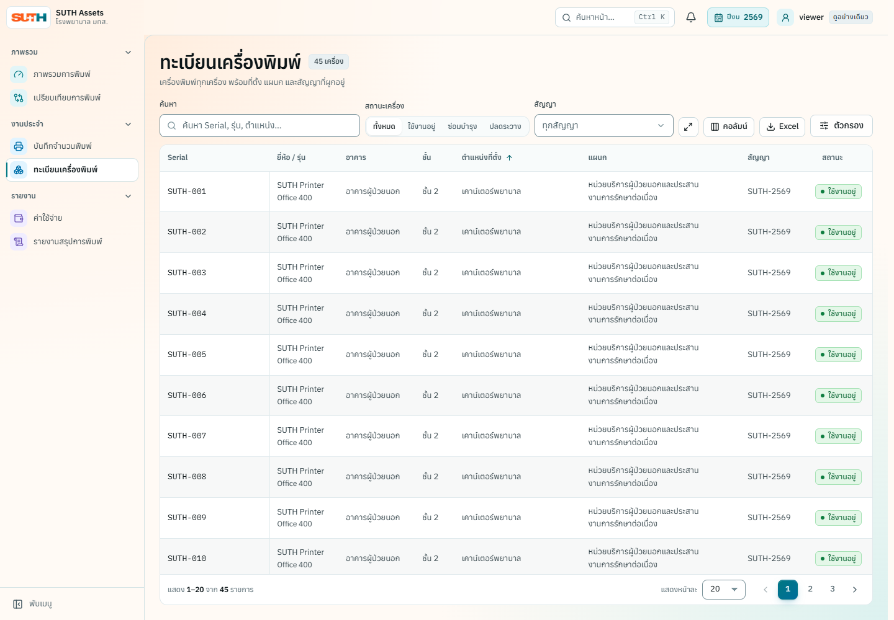
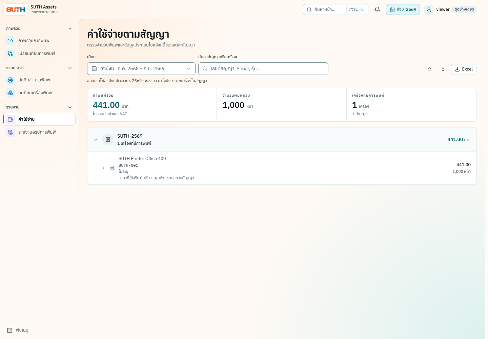

# โครงงานฝึกงาน — Hospital IT Asset Management

**ผู้รับผิดชอบ:** WayuOHm99 · **ช่วงฝึกงาน:** 8 มิถุนายน–12 ตุลาคม 2026

รับผิดชอบการพัฒนาระบบครบวงจรภายใต้การดูแลของพี่เลี้ยง ตั้งแต่พัฒนา frontend/backend ตรวจสอบการทำงาน จัดทำเอกสาร และส่งมอบระบบ ประวัติ Git มีผู้ร่วมพัฒนาคนอื่นด้วย และสำเนานี้คงเครดิตทุกคนไว้

ระบบช่วยเจ้าหน้าที่ IT จัดการทะเบียนเครื่องพิมพ์ สัญญา จำนวนพิมพ์รายเดือน และรายงานค่าใช้จ่ายตามปีงบประมาณ อ่านภาพรวมเทคโนโลยีและวิธีเปิดระบบที่ [README](../../README.md)

## 1. Dashboard ที่ใช้ขอบเขตข้อมูลเดียวกัน

**โจทย์:** ผู้ใช้ต้องวิเคราะห์และส่งออกข้อมูลที่สอดคล้องกัน แม้เลือกหลายปีงบหรือหลายหน่วยงาน และต้องแชร์ลิงก์ตัวกรองได้

**สิ่งที่พัฒนา:** รวมการวิเคราะห์เป็นหน้าที่มีตัวกรองชุดเดียว ให้ KPI กราฟ ตาราง รายละเอียด และไฟล์ส่งออกใช้ขอบเขตเดียวกัน เก็บสถานะใน URL และรองรับลิงก์หน้ารุ่นเดิม

**หลักฐาน:** [PR #127](https://github.com/saritrungj/suth-helpdesk-assets/pull/127) รายงาน web unit 245/245, fixture E2E 131/131 และ QA database 178/178 พร้อม regression ของการสลับปีงบและตัวกรอง

**ข้อจำกัดในหลักฐานรอบนั้น:** PR ระบุว่ายังไม่ได้ตรวจหน้าจอจริงด้วยตาครบตามเกณฑ์ จึงไม่ใช้ผลอัตโนมัติแทนการยืนยันด้านภาพและการใช้งาน

**ประเด็นสัมภาษณ์:** อธิบายการดูแล URL state, การทดสอบ Back/Forward และวิธีพิสูจน์ว่าตัวกรองส่งผลถึงไฟล์ส่งออกจริง

## 2. นำเข้าข้อมูลโดยตรวจแผนก่อนยืนยัน

**โจทย์:** การเปิดไฟล์เพื่อตรวจไม่ควรทำให้ข้อมูลธุรกิจถูกสร้างก่อนผู้ใช้ยืนยัน

**สิ่งที่พัฒนา:** เก็บสิ่งที่จะสร้างหรือแก้เป็นแผน แสดงผลลัพธ์ที่จะเกิดเมื่อกดยืนยัน และบันทึกข้อมูลที่เกี่ยวข้องใน transaction เดียวกัน รองรับการแก้แผนและยกเลิกงาน

**หลักฐาน:** [PR #210](https://github.com/saritrungj/suth-helpdesk-assets/pull/210) รายงาน import-session database specs 6/6 บนฐานชั่วคราว พร้อมการตรวจ zip-limit และ fixture

**ข้อจำกัด:** หลักฐานนี้เป็นของ candidate ใน PR ดังกล่าว ไม่ใช่การรับรองทุกเส้นทางนำเข้าของสำเนาปัจจุบัน

**ประเด็นสัมภาษณ์:** อธิบายการแยก preview กับ commit, transaction boundary และการออกแบบข้อความยืนยันที่ทำให้ผู้ใช้เข้าใจผลกระทบ

## 3. อ่าน CSV ภาษาไทยจาก Excel

**โจทย์:** CSV ที่ผู้ใช้งานบันทึกจาก Excel อาจใช้ Windows-874 หรือ UTF-16 แทน UTF-8

**สิ่งที่พัฒนา:** เพิ่มลำดับการถอดรหัสตาม BOM และ encoding ที่รองรับ ปฏิเสธข้อมูลที่มีอักขระทดแทนจากการถอดรหัสผิด พร้อมข้อความที่ช่วยให้ผู้ใช้แก้ไฟล์

**หลักฐาน:** [PR #234](https://github.com/saritrungj/suth-helpdesk-assets/pull/234) รายงาน API tests 254 เคส รวมเคส encoding ใหม่ 6 เคส และระบุเคสที่แดงก่อนแก้

**ข้อจำกัด:** บาง encoding อื่นอาจอ่านผ่าน Windows-874 แต่ให้ข้อความผิดความหมายได้ PR รอบนั้นไม่ได้รัน QA database suite และไม่ได้ตรวจข้อความผ่านเบราว์เซอร์

**ประเด็นสัมภาษณ์:** อธิบายความต่างระหว่างการถอดรหัสสำเร็จกับข้อความถูกความหมาย และเหตุผลที่ควรทดสอบด้วยไบต์จริง

## 4. ขยายการตรวจ Accessibility

**โจทย์:** การตรวจเพียงหน้าเริ่มต้นไม่ครอบคลุมหน้าจริงและสถานะ loading, error หรือ empty ของผู้ใช้

**สิ่งที่พัฒนา:** เพิ่ม inventory ของ route/role/state และตรวจหน้าที่เกี่ยวข้องผ่าน HTTP fixtures พร้อมแก้ semantic labels และหัวเรื่องที่การตรวจพบปัญหา

**หลักฐาน:** [PR #293](https://github.com/saritrungj/suth-helpdesk-assets/pull/293) รายงาน 67 tests ของชุดใหม่ โดยมี 64 scans จาก 16 route/state pairs × 2 themes × 2 viewports และ Compare เพิ่มอีก 2 scans

**ข้อจำกัด:** ไม่ได้ทดสอบ screen reader จริงหรือ usability กับผู้ใช้ และไม่อ้างว่า automated checks รับรอง WCAG compliance ของทั้งระบบ

**ประเด็นสัมภาษณ์:** อธิบายการเลือก coverage ตาม route/state และการนำผลตรวจอัตโนมัติมายืนยันกับหน้าจอจริง

## 5. เทสค่าใช้จ่ายและการนำเข้าซ้ำ

**โจทย์:** การแก้ราคาในสัญญาที่มีหลายรายการราคาและเครื่องราคาพิเศษต้องให้ยอดถูกต้อง ขณะที่การนำเข้าไฟล์ซ้ำด้วยยอดใหม่ต้องเขียนทับอย่างถูกต้อง

**สิ่งที่พัฒนา:** เพิ่ม E2E ที่เปรียบเทียบยอดในหน้าดูผลกระทบกับผลหลังบันทึก และเพิ่มเคส re-import ที่ตรวจจำนวนรายการเขียนทับและยอดรายงาน

**หลักฐาน:** [PR #328](https://github.com/saritrungj/suth-helpdesk-assets/pull/328) รายงาน QA database suite 205 passed, 0 failed และไม่มีงานนำเข้าค้างหลังจบชุด

**ข้อจำกัด:** เป็นการเพิ่ม coverage ของพฤติกรรมที่ถูกอยู่แล้ว เทสใหม่ผ่านตั้งแต่ครั้งแรก จึงไม่มีรอบแดง PR ระบุช่องว่างอื่นไว้ เช่น การเปลี่ยนอายุสัญญาและไฟล์ที่มีแถวถูกผิดปนกัน

**ประเด็นสัมภาษณ์:** อธิบายการคำนวณ expected result แยกจาก UI และเหตุผลที่การนำเข้าซ้ำต้องไม่เพิ่มยอดซ้ำ

## ข้อความสำหรับ CV

**Full-stack Developer Intern · Hospital IT Asset Management**

**8 June–12 October 2026**

- Owned end-to-end development of a hospital IT asset management internship project under mentor supervision, using Vue 3, Express and MySQL.
- Implemented analytics, import confirmation and Thai CSV compatibility, with shared domain rules and documented technical decisions.
- Expanded automated verification through unit tests, browser workflows, accessibility checks and isolated database scenarios.

ฉบับภาษาไทย: รับผิดชอบพัฒนาระบบบริหารทรัพย์สิน IT สำหรับโรงพยาบาลครบวงจรภายใต้การดูแลของพี่เลี้ยง โดยใช้ Vue 3, Express และ MySQL พัฒนา Dashboard และกระบวนการนำเข้าข้อมูล พร้อมขยายการทดสอบและจัดทำเอกสารส่งมอบ

ผลทดสอบที่ระบุด้านบนมาจากบันทึกใน PR ต้นทาง ณ เวลาส่งงาน ไม่ใช่ผลรันใหม่ในรอบจัด Portfolio ไม่ระบุผลประหยัดเวลา งบประมาณ หรือจำนวนผู้ใช้ เพราะยังไม่มีหลักฐานรองรับในชุดนี้

## สถานะสำเนา Portfolio

สำเนาส่วนตัวนี้เริ่มเป็น private ใช้ tracker ของตัวเอง และเก็บ LICENSE/เครดิตต้นทาง ประวัติเก่าที่มี environment, ไฟล์อัปโหลด, Excel ใน docs และ dependency folders ถูกนำออกจากสำเนาที่อัปโหลด โดยไม่เปลี่ยนไฟล์แอปปัจจุบัน

ยังไม่มี hosted demo หรือคลิปแนะนำของสำเนานี้ หากต้องแชร์กับผู้สัมภาษณ์ ตรวจขอบเขตการเปิดเผยกับพี่เลี้ยงก่อนเผยแพร่

## ภาพตัวอย่างจากข้อมูลจำลอง

ภาพที่คัดเลือกสำหรับ Portfolio ถ่ายวันที่ 12 ตุลาคม 2026 ด้วย Chromium ที่ 1440 × 1000 จากแอปต้นทางซึ่งมีไฟล์ apps และ packages ตรงกับสำเนานี้ ข้อมูลทั้งหมดมาจาก asset/prototype/comparison fixtures ในชุด E2E โดย intercept API ในเบราว์เซอร์และปิดคำขอภายนอกที่เหลือ ไม่เชื่อมต่อหรือบันทึกฐานข้อมูลจริง

ตัวเลข fixture สำหรับภาพค่าใช้จ่ายปรับให้สอดคล้องกับกฎหักจำนวนหน้าและการปัดเงินใน [ADR-0017](../decisions/0017-two-percent-page-deduction.md) และ [ADR-0022](../decisions/0022-round-at-invoice-line-and-allocate.md) โดยปรับเฉพาะข้อมูลจำลองของการถ่ายภาพ

ภาพเหล่านี้เป็นภาพอธิบายผลิตภัณฑ์สำหรับ Portfolio ไม่ใช่ screenshot baseline หรือหลักฐานว่าทุก workflow ผ่านการทดสอบในรอบนี้

**ทะเบียนเครื่องพิมพ์:** ค้นหา กรองสถานะ และดูทะเบียนในตาราง

**รายงานค่าใช้จ่าย:** ยอดสรุปตามสัญญาและรายละเอียดเครื่อง

**Dashboard:** [ภาพหน้าภาพรวมการพิมพ์](images/dashboard.png)
